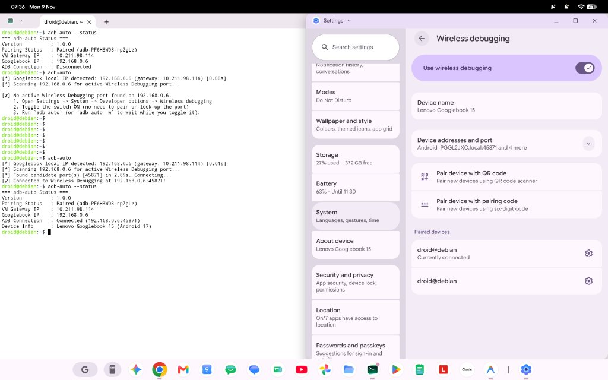
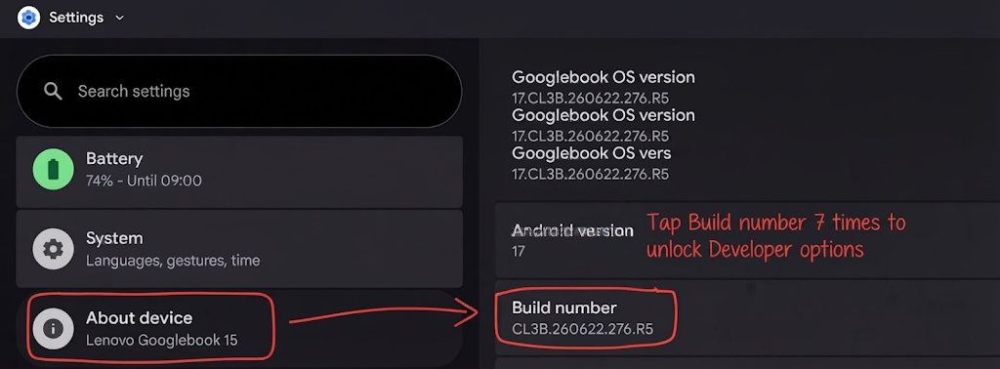
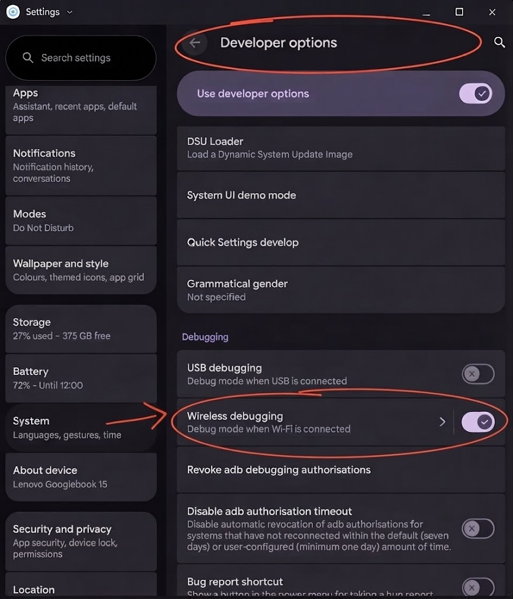
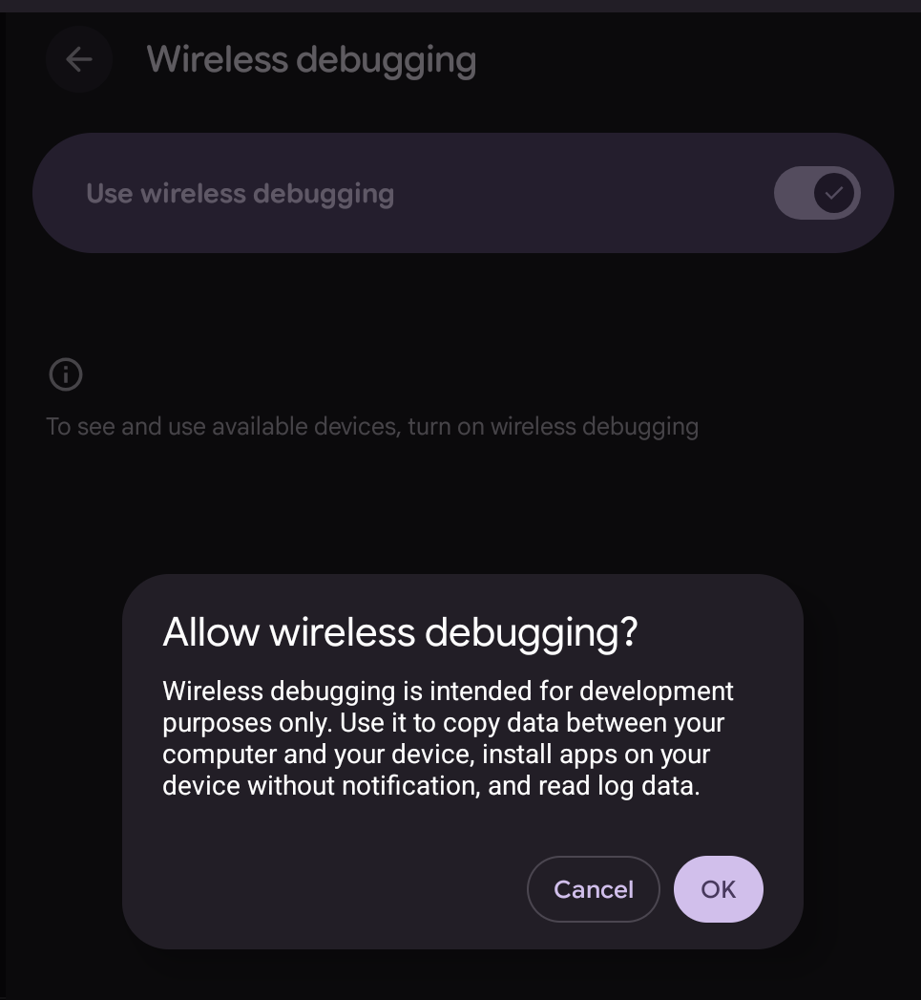
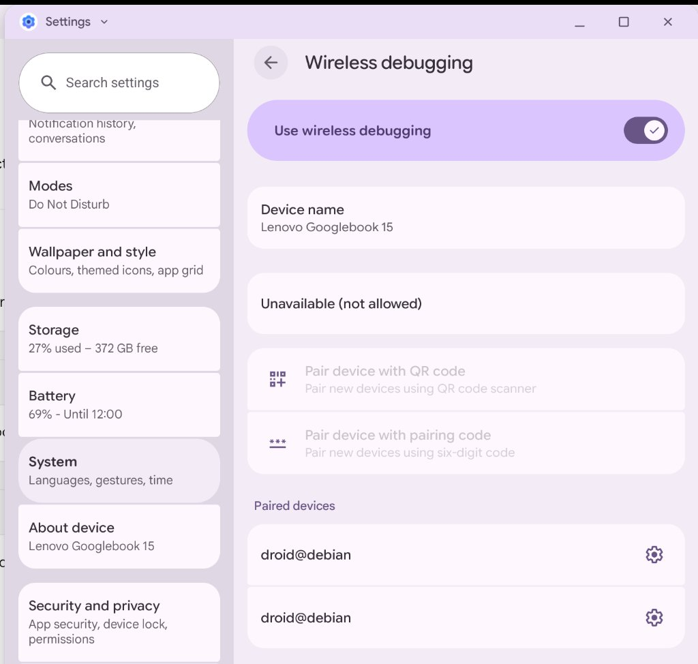
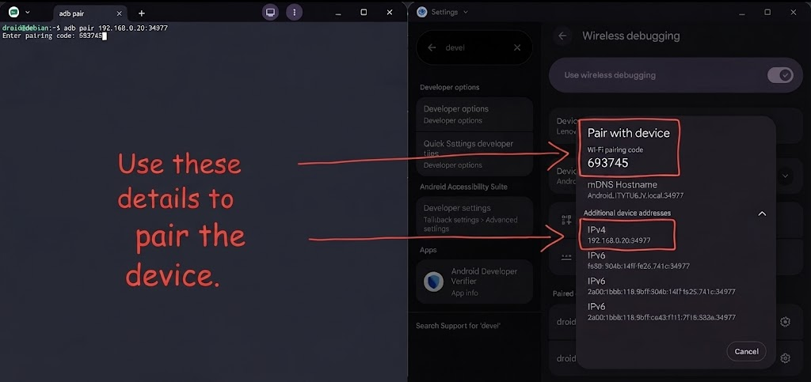

# `adb-auto` — Wireless ADB Auto-Connector for Googlebook

[](https://www.gnu.org/licenses/old-licenses/gpl-2.0.en.html)
[](https://deepmind.google/)

A minimalist Debian CLI tool that automatically connects the **Googlebook (Android Laptop)** Linux terminal to Android Wireless Debugging—no manual IP address or random port lookups required.

> **Credits:** Created by **[Igor Jagec (@Aryston)](https://github.com/Aryston)**, vibe-coded with **Google Antigravity** (Google DeepMind), and QA tested by **Denny Lockhart**. Licensed under **GNU GPL v2.0**.



---

## Prerequisite: Enable Wireless Debugging on Googlebook

`adb-auto` requires **Use wireless debugging** to be turned **ON** in Android Settings:

1. Go to **Settings -> About device** and tap **Build number** 7 times until Developer options unlock.
   
2. Go to **Settings -> System -> Developer options** and tap **Wireless debugging**.
   
3. Toggle on **Use wireless debugging** and accept the **Allow wireless debugging?** prompt.
   

> **Note on Sleep / Disconnections:** Android automatically suspends Wireless Debugging after sleep or Wi-Fi changes (sometimes showing `Unavailable (not allowed)` while the switch still looks ON). If connection fails, toggle **Use wireless debugging** OFF and back ON, then run `adb-auto`.
>
> 

---

## Installation

Add the [`googlebook-tools`](https://salsa.debian.org/prospero/googlebook-tools) APT repository on Debian Salsa to install `/usr/bin/adb-auto`, the `man adb-auto` page, required system dependencies (`adb`, `python3`, `iproute2`, `iputils-ping`), and receive automatic `apt` updates:

```bash
echo "deb [trusted=yes] https://salsa.debian.org/prospero/googlebook-tools/-/raw/main apt/" | sudo tee /etc/apt/sources.list.d/googlebook-tools.list
sudo apt update
sudo apt install -y adb-auto
```

---

## First-Time Pairing (`adb-auto --pair`)

You only need to pair **once**:

1. In **Settings -> System -> Developer options -> Wireless debugging**, tap **Pair device with pairing code** to display the 6-digit PIN:
   
   
2. Keep that popup open and run:
   ```bash
   adb-auto --pair
   ```
   Enter the 6-digit PIN when prompted (no IP or port needed!). `adb-auto` pairs and connects automatically.

---

## Daily Usage & Options (`adb-auto --help`)

Once paired, simply run `adb-auto` anytime Wireless Debugging is ON:

```text
usage: adb-auto [-h] [-p [PIN]] [-s] [-d] [-V]

Connect Googlebook Linux terminal to Android Wireless Debugging automatically.

options:
  -h, --help          Show this help message and exit
  -p, --pair [PIN]    Pair device using 6-digit PIN (first-time setup)
  -s, --status        Show pairing state, IP addresses, and connection status
  -d, --disconnect    Disconnect all ADB sessions
  -V, --version       Show version and license information
```

### Examples

```bash
# Connect automatically (when Wireless Debugging is ON)
adb-auto

# Pair for the first time (prompts for 6-digit PIN)
adb-auto --pair

# Pair with PIN 123456 and connect immediately
adb-auto --pair 123456

# Check pairing and connection status
adb-auto --status

# Disconnect ADB
adb-auto --disconnect
```

---

## Building From Source

Rebuild both `dist/adb-auto_1.0.0_all.deb` and `dist/adb-auto-1.0.0.tar.gz`:

```bash
./build_release.sh
```

---

## License

Distributed under the **GNU General Public License v2.0 (GPL-2.0-only)**. See [LICENSE](LICENSE) for full details.
