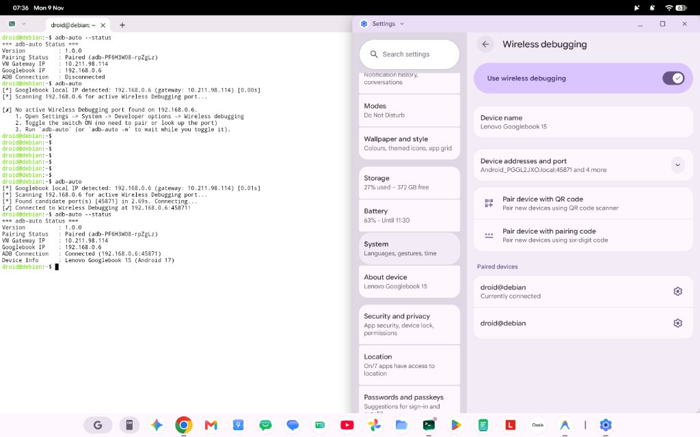
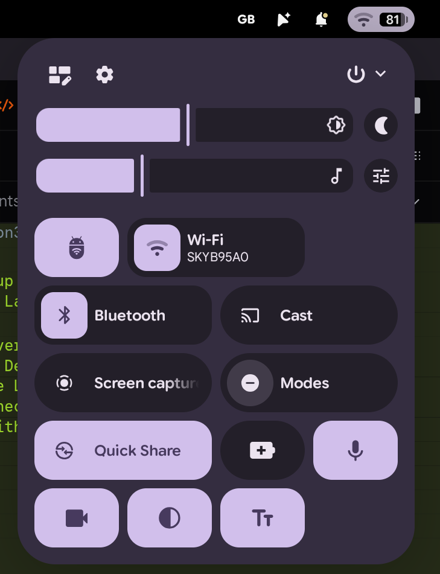

# `adb-auto` — Wireless ADB Auto-Connector for Googlebook

[](https://www.gnu.org/licenses/old-licenses/gpl-2.0.en.html)
[](https://deepmind.google/)
[](https://salsa.debian.org/prospero/googlebook-tools)

A minimalist Debian CLI utility that automatically bridges the Googlebook Linux terminal (Debian container) to host Android Wireless Debugging without manual IP lookups or port scanning.

> **Credits:** Created by **[Igor Jagec (@Aryston)](https://github.com/Aryston)**, vibe-coded with **Google Antigravity** (Google DeepMind), and QA tested by **Denny Lockhart**. Licensed under **GNU GPL v2.0**.



---

## Why adb-auto?

On Googlebook OS, Android assigns a **random, dynamic TCP port** to Wireless Debugging every time the service starts, after waking from sleep, or following a Wi-Fi reconnect. Furthermore, Android frequently suspends inactive debugging sessions, displaying `"Unavailable (not allowed)"`.

Normally, reconnecting requires:
1. Navigating through multiple Android Settings menus.
2. Manually checking the new dynamic port number.
3. Typing `adb connect <ip>:<port>` in the Linux terminal.

**`adb-auto` turns this into a zero-lookup workflow:** after a quick one-off setup, it automatically locates the host gateway, fingerprints the active dynamic ADB port, and establishes the connection in seconds.

---

## Installation

Add the [`googlebook-tools`](https://salsa.debian.org/prospero/googlebook-tools) APT repository on Debian Salsa to install `/usr/bin/adb-auto`, the `man adb-auto` page, required system dependencies (`adb`, `python3`, `iproute2`, `iputils-ping`), and receive automatic `apt` updates:

```bash
echo "deb [trusted=yes] https://salsa.debian.org/prospero/googlebook-tools/-/raw/main apt/" | sudo tee /etc/apt/sources.list.d/googlebook-tools.list
sudo apt update
sudo apt install -y adb-auto
```

---

## The One-Off Setup (Do This Once)

To make future connections effortless, complete these one-time steps on your Googlebook:

### 1. Unlock Developer Options & Enable the Quick Settings Tile

Android automatically suspends background Wireless Debugging after sleep or network changes. Adding the developer tile turns waking ADB back up into a **1-second, single-click fix** instead of digging through menus:

1. Open **Settings > About device** and tap **Build number** 7 times.
   
2. Go to **Settings > System > Developer options > Quick Settings developer tiles**.
3. Toggle ON **Wireless debugging**.
4. Pull down or click the status tray in the **top-right corner** of your screen: you will now see the **Android bug icon** tile appear right next to your Wi-Fi tile.
   

### 2. One-Time Device Pairing

Android security requires physical authorization for the first connection:

1. In **Settings > System > Developer options > Wireless debugging**, tap **Pair device with pairing code** to view your 6-digit Wi-Fi pairing code and pairing port.
   
2. In your terminal, pair using standard ADB:
   ```bash
   adb pair <IP>:<PAIRING_PORT>
   ```
3. Enter the 6-digit PIN when prompted.

---

## Daily Usage: How It Works

Once the one-off setup is complete, reconnecting is completely seamless:

- **When Wireless Debugging is active:** Just run:
  ```bash
  adb-auto
  ```
- **When connection drops or Android suspends debugging (`Unavailable`):**
  1. Click or pull down the Quick Settings tray from the top right.
  2. Tap the **Android bug tile** off and back on (purple = active).
  3. Run `adb-auto` in your terminal.

---

## Options & Commands (`adb-auto --help`)

```text
usage: adb-auto [-h] [-s] [-d] [-V]

Connect Googlebook Linux terminal to Android Wireless Debugging automatically.

options:
  -h, --help        Show this help message and exit
  -s, --status      Show pairing state, IP addresses, and connection status
  -d, --disconnect  Disconnect all ADB sessions
  -V, --version     Show version and license information
```

### Examples

```bash
# Connect automatically (when Wireless Debugging is active)
adb-auto

# Check pairing state and connection status
adb-auto --status

# Disconnect ADB
adb-auto --disconnect
```

---

## Building From Source

To build the native Debian package (`dist/adb-auto_1.3.0_all.deb`):

```bash
./build_release.sh
```

To install the newly built package locally:

```bash
sudo dpkg -i dist/adb-auto_1.3.0_all.deb
```

---

## License

Distributed under the **GNU General Public License v2.0 (GPL-2.0-only)**. See [LICENSE](LICENSE) for full details.
